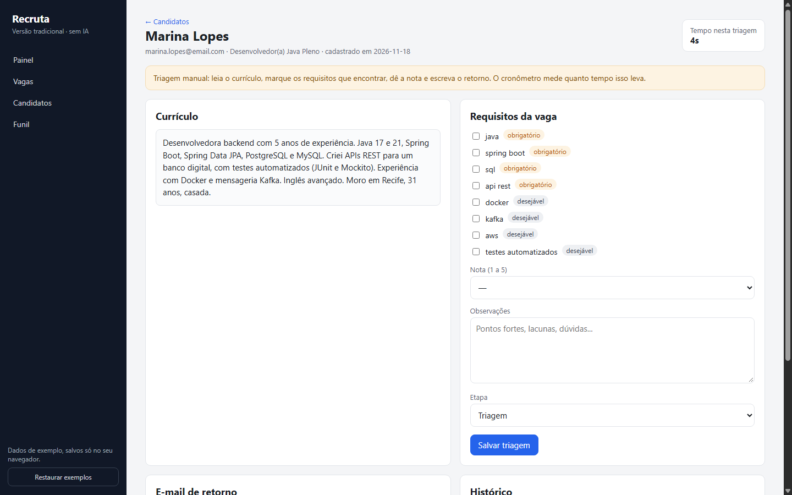
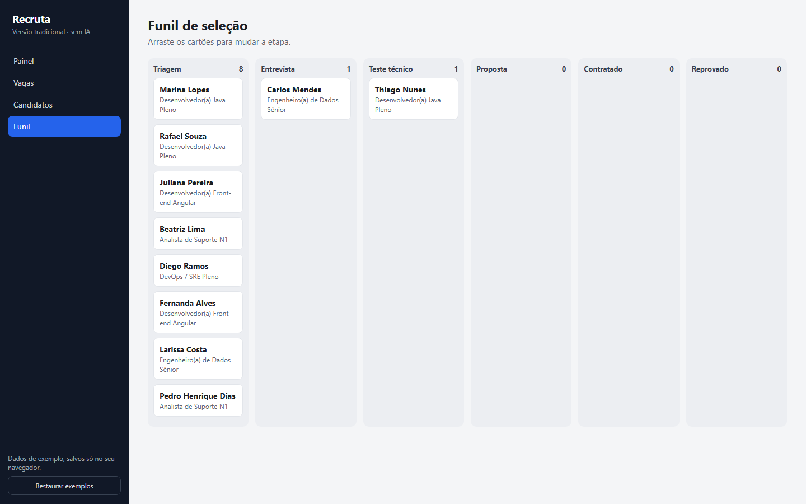

# Recruta: sistema de recrutamento tradicional (sem IA)

**Demo ao vivo:** https://phb29.github.io/recruta-sem-ia/
**A mesma aplicação com IA:** [recruta-com-ia-rag-agentes](https://github.com/Phb29/recruta-com-ia-rag-agentes) · [demo](https://phb29.github.io/recruta-com-ia-rag-agentes/)

Este é o **ponto de partida** de uma comparação. É um sistema web de recrutamento como muitos que existem por aí: cadastro de vagas, cadastro de candidatos, funil em kanban e uma tela de triagem. Tudo é feito à mão.

O segundo repositório pega **exatamente esta aplicação**, com as mesmas telas e os mesmos dados, e adiciona RAG, agentes de IA e um orquestrador. Assim dá para ver o que muda de verdade quando a IA entra no processo.



## O que tem aqui

- **Painel:** vagas, candidatos, funil por etapa e a fila estimada de leitura (15 min por currículo).
- **Vagas:** requisitos obrigatórios e desejáveis.
- **Candidatos:** lista com busca por texto exato.
- **Triagem:** o(a) recrutador(a) lê o currículo, marca os requisitos, dá a nota, escreve observações e adapta um e-mail genérico. **Um cronômetro mede quanto tempo isso leva.**
- **Funil:** kanban com arrastar e soltar.

## Onde dói (e é isso que a versão com IA resolve)

| Dor | Na prática |
|---|---|
| Leitura manual | Cada currículo leva cerca de 15 minutos. 10 currículos são 2,5 horas. |
| Regras na cabeça | Faixa de senioridade, prazos e LGPD ficam em documentos que ninguém abre na hora. |
| Viés | Idade, cidade e estado civil aparecem na tela de quem avalia. |
| Busca literal | Procurar "k8s" não encontra quem escreveu "Kubernetes". |
| Vaga errada | Um bom candidato que se inscreveu na vaga errada costuma ser reprovado. |
| Retorno genérico | O e-mail é um modelo com `[ESCREVA AQUI O RETORNO]`. |

| | |
|---|---|
|  |  |

## Rodar localmente

```bash
git clone https://github.com/Phb29/recruta-sem-ia.git
cd recruta-sem-ia
npx serve .          # ou: python -m http.server 8000
```

HTML, CSS e JavaScript puro, sem build e sem backend. Os dados são fictícios e ficam no `localStorage` do navegador.
